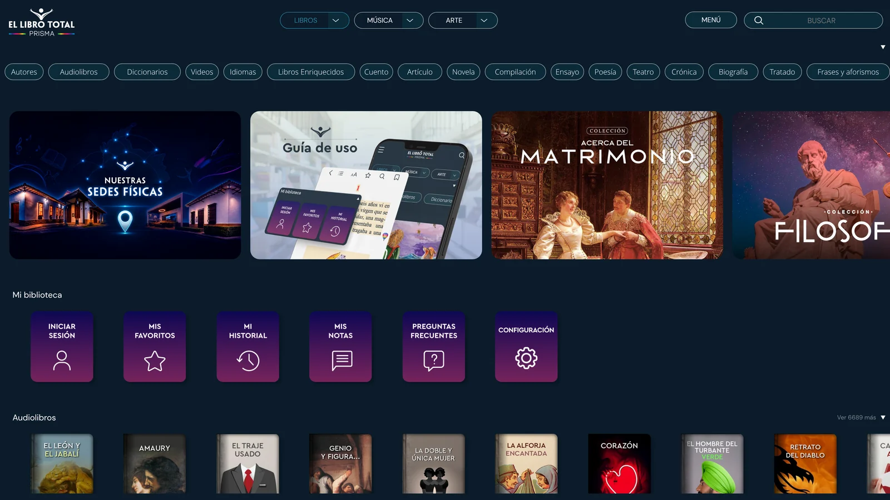
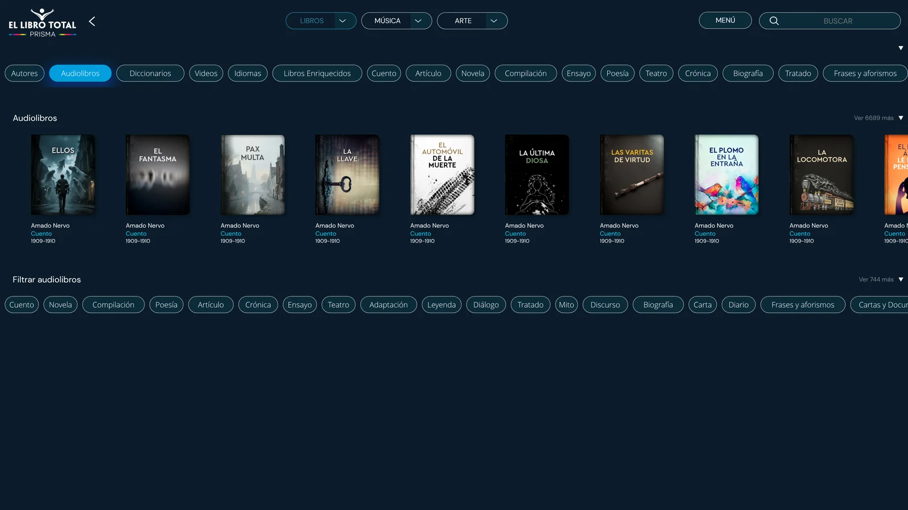
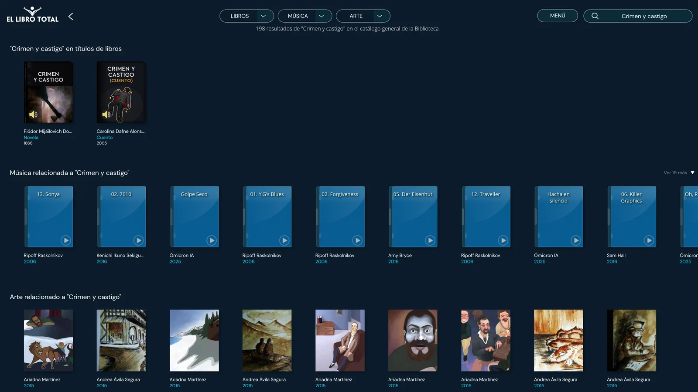
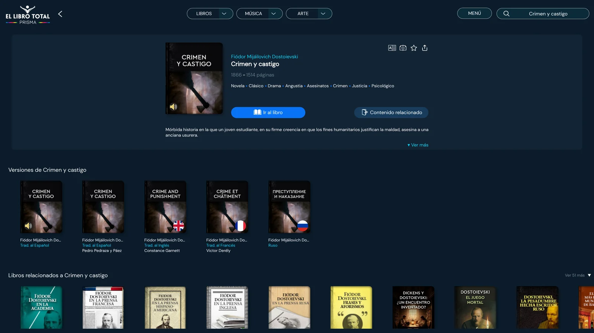
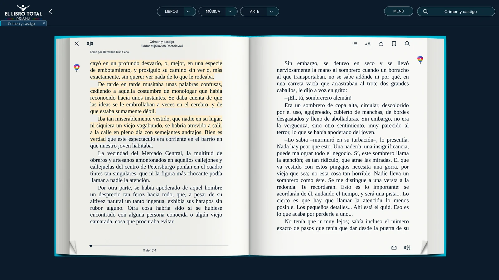
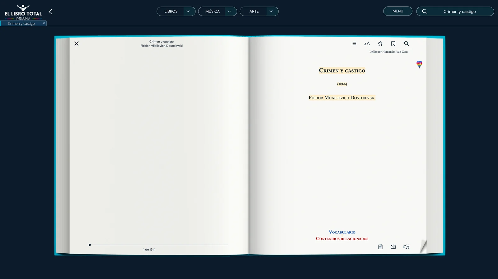
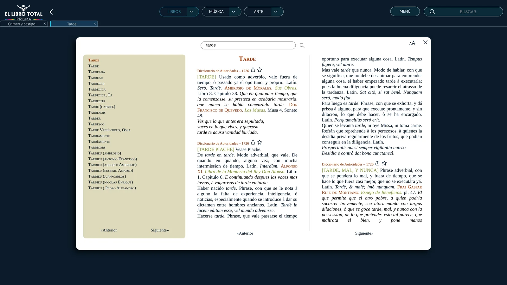
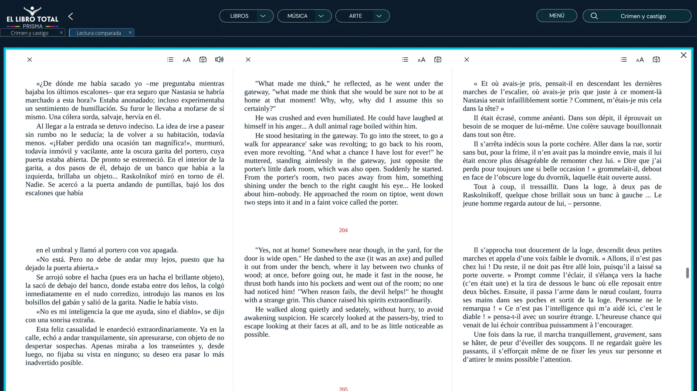
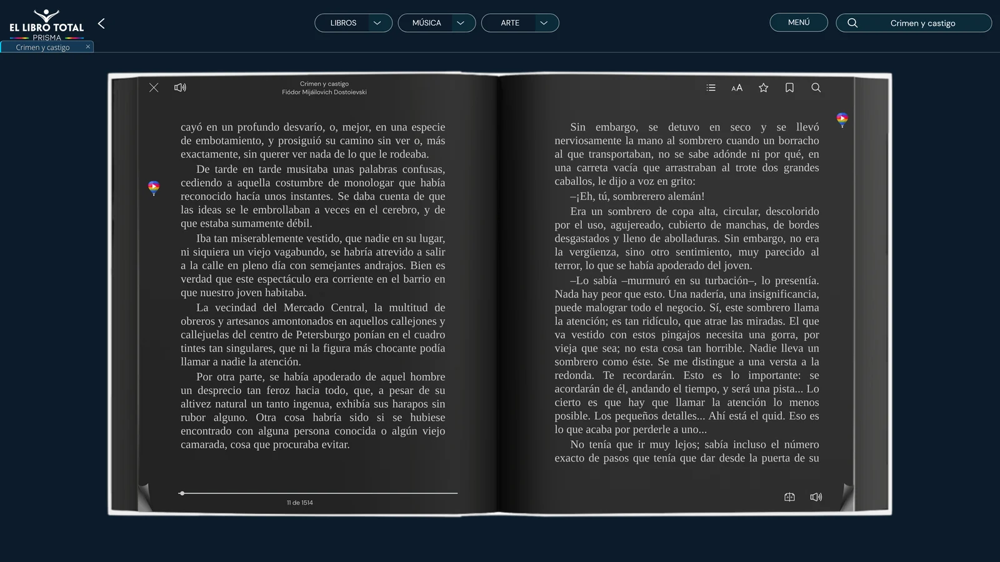
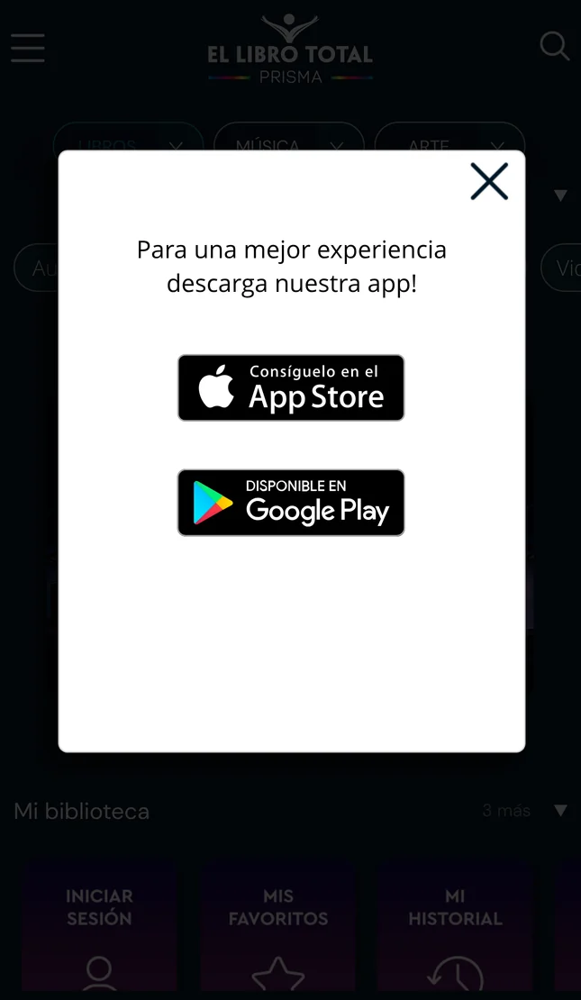

# El Libro Total: reseña completa de la biblioteca gratuita con 6.698 audiolibros

**Más de 5 millones de descargas, una valoración de 4,8 a 4,9 estrellas y un precio de cero euros.** Sin anuncios, sin suscripción y sin pedirte ni el correo para escuchar. Hemos probado El Libro Total a fondo, en la web, en el móvil y en sus apps, para responder a la pregunta que todo el mundo se hace: **¿dónde está la trampa?**

> **Veredicto rápido · 8,2/10**
> El Libro Total es probablemente **la mejor biblioteca gratuita de clásicos en español con audio narrado por voces humanas**. No tiene novedades ni superventas, y su reproductor es básico: no hay audio sin conexión ni temporizador. Pero para estudiantes, amantes de los clásicos y quien aprende idiomas, es difícil encontrar algo mejor… sin pagar un euro.

[VÍDEO: insertar aquí la reseña de YouTube de SonorBooks]

## Ficha técnica

| | El Libro Total |
|---|---|
| **Precio** | Gratis (0 €), sin suscripción, sin anuncios y sin compras dentro de la app anunciadas |
| **Registro** | Opcional. Para leer y escuchar no hace falta cuenta |
| **Audiolibros** | 6.698 (contador de la web, 10-oct-2026), casi todos en español |
| **Catálogo total** | «Más de 50.000 títulos» y «más de 220.000 contenidos» con música, arte y vídeo (según la propia plataforma) |
| **Tipo de obras** | Dominio público y obras cedidas por sus autores. No hay novedades editoriales |
| **Voces** | Humanas, acreditadas como «Leído por…» |
| **Formato del audio** | Streaming MP3 a 64 kbps (un archivo por página) |
| **Velocidad de reproducción** | 0,8× a 2× en móvil; no disponible en la web de escritorio |
| **Audio sin conexión** | No anunciado (sin conexión solo se lee texto: EPUB y PDF) |
| **Plataformas** | Web, Android («Libro Total Libros AudioLibros») e iPhone/iPad («El Libro Total») |
| **Valoración en tiendas** | Google Play: 4,8 en España y 4,9 en Colombia, con unas 52.000 valoraciones y más de 5 M de descargas. App Store: 4,82 en España |
| **Quién está detrás** | Fundación El Libro Total (Colombia, 2005), sin ánimo de lucro, financiada por Sistemas y Computadores S.A. |

**Índice**
1. [Qué es El Libro Total](#que-es-el-libro-total)
2. [¿Es realmente gratis? ¿Dónde está la trampa?](#es-realmente-gratis)
3. [Cómo funciona, paso a paso](#como-funciona)
4. [La audiolectura a fondo: voces, calidad y controles](#la-audiolectura-a-fondo)
5. [Herramientas que no tiene nadie más](#herramientas)
6. [La app: qué cambia en el móvil](#la-app)
7. [Puntos fuertes y puntos débiles](#pros-y-contras)
8. [¿Para quién es (y para quién no)?](#para-quien-es)
9. [Precio y comparativa con Audible, Spotify y LibriVox](#comparativa)
10. [Nuestra nota](#nota)
11. [Preguntas frecuentes](#preguntas-frecuentes)

---

## 1. Qué es El Libro Total

El Libro Total se presenta como **«La Biblioteca digital de América»**. Es una biblioteca online gratuita nacida en **Bucaramanga (Colombia)**:

- **Quién la mantiene:** la **Fundación El Libro Total**, una entidad **sin ánimo de lucro** creada en **2005**. La biblioteca digital arrancó en 2006.
- **Quién la financia:** **Sistemas y Computadores S.A. (SYC)**, una empresa colombiana de software y servicios tecnológicos.
- **El nombre:** es un guiño a Jorge Luis Borges y a su ensayo *La biblioteca total* (1939), precursor de *La biblioteca de Babel*. El texto está, por supuesto, en la propia plataforma.

No es solo una biblioteca de libros. En la parte superior verás tres grandes «mundos»: **Libros, Música y Arte**. Debajo hay decenas de secciones: autores, audiolibros, diccionarios, vídeos, idiomas, libros enriquecidos y géneros que van del cuento a la crónica. Algunas cifras que muestra la propia web (10 de octubre de 2026):

- **6.698 audiolibros**
- **21.504 libros en español**, y otros en inglés, francés, italiano, ruso, alemán y portugués
- **459 obras «confrontadas»** con otros idiomas, para leer el original y la traducción lado a lado
- Más de **1.000 vídeos** y miles de piezas musicales y obras de arte vinculadas a los libros

*La portada de El Libro Total (versión «Prisma»), con los tres mundos: libros, música y arte.*

Fuera de internet, la fundación tiene las **Casas del Libro Total**: espacios culturales gratuitos en varias ciudades colombianas (Bucaramanga, San Gil, Arauca, Zapatoca…) con lecturas, exposiciones y cine. Son a la vez, curiosamente, **puntos de pago de impuestos departamentales**. En pocos sitios del mundo puedes pagar el impuesto del coche y asistir a un recital de poesía en el mismo edificio.

## 2. ¿Es realmente gratis? ¿Dónde está la trampa?

**Sí, es gratis de verdad.** Sus propias preguntas frecuentes lo dicen sin rodeos: *«Los servicios y la navegación en la biblioteca digital El Libro Total son completamente gratuitos y sin fines comerciales»*. No hay anuncios, no hay suscripción y las apps no anuncian compras internas.

¿Cómo es posible? Por dos razones:

1. **El mecenazgo de una empresa.** La fundación está respaldada por Sistemas y Computadores S.A., que la financia como proyecto de responsabilidad social.
2. **El tipo de catálogo.** El Libro Total publica **obras de dominio público** y obras cuyos autores o traductores **han autorizado** su difusión sin ánimo de lucro. Por eso no encontrarás el último superventas: no es un fallo, es su modelo.

La «trampa», por tanto, no está en el precio, sino en lo que **no** encontrarás: novedades, thrillers de moda o la experiencia de reproductor «premium» de las apps de pago. Volvemos sobre ello en los [puntos débiles](#pros-y-contras).

## 3. Cómo funciona, paso a paso

### Paso 1. Entra en la sección Audiolibros
Desde la portada, pulsa **Audiolibros**. Verás el contador (6.698 títulos) y, debajo, **«Filtrar audiolibros»**, con más de 750 filtros por género (cuento, novela, poesía, teatro…) y por temas tan concretos como *misterio*, *fantasmas* o *amores imposibles*.

En las portadas, **los libros con audio llevan un icono de altavoz**. Es la forma rápida de distinguirlos del resto.

*La sección Audiolibros, con su contador y los filtros por género y por temas.*

Un dato que conviene saber: **la mayoría son cuentos**. En una muestra aleatoria de 200 audiolibros, el 79 % eran cuentos, la duración mediana era de **17,6 minutos** y dos de cada tres duraban menos de media hora. También hay obras largas completas: *Crimen y castigo* dura unas **26,6 horas** y *Ana Karenina* casi **41 horas**.

### Paso 2. Busca un libro
El buscador está arriba a la derecha y es, con diferencia, lo más rápido. Al buscar **«Crimen y castigo»** no solo aparece la novela. También salen **música inspirada en la obra, ilustraciones y artículos relacionados**: en El Libro Total todo está conectado.

*Al buscar «Crimen y castigo» aparecen el libro, música y arte relacionados.*

### Paso 3. Abre la ficha
La ficha muestra la sinopsis, las etiquetas temáticas y, en muchos clásicos, **varias versiones de la obra**. En *Crimen y castigo* hay dos traducciones al español (una de ellas de Pedro Pedraza y Páez), la inglesa de Constance Garnett, la francesa de Victor Derély y **el original en ruso**.

*La ficha del libro, con las versiones en español, inglés, francés y ruso.*

### Paso 4. Pulsa «Ir al libro» y activa la audiolectura
El libro se abre en un lector con aspecto de **libro físico**, con sus dos páginas y su animación al pasar la hoja. Para escuchar, pulsa el **altavoz** o el **globo aerostático** de colores que aparece en el margen. A partir de ahí:

- **El texto de la página se resalta** mientras suena.
- **El globo baja por el margen** indicando, de forma aproximada, por dónde va la narración.
- **Las páginas pasan solas.** Puedes leer y escuchar a la vez.

*Audiolectura en marcha: la página se resalta y el globo avanza por el margen.*

**¿Hace falta registrarse?** No. Nosotros hemos leído y escuchado sin cuenta. Si te registras (gratis, con nombre, correo y contraseña), ganas **historial y «seguir leyendo», favoritos, marcadores y un cuaderno de notas**. Ojo: no hay inicio de sesión con Google ni con Apple.

## 4. La audiolectura a fondo: voces, calidad y controles

### Voces humanas, con nombre propio
Aquí está la gran diferencia con otras bibliotecas gratuitas: **los audiolibros están narrados por personas**, no por un sintetizador. El propio desarrollador lo dejó claro en Google Play en agosto de 2026: *«son voces naturales, no son un lector automático»*.

Cada audiolibro acredita a su narrador con un rótulo **«Leído por…»**. *Crimen y castigo*, por ejemplo, lo lee **Hernando Iván Cano**. En nuestra muestra de 200 títulos, seis voces sumaban cerca del 81 % de los créditos:

- **Álvaro Gómez Zafra:** el más habitual, con un 35 %.
- **Hernando Iván Cano, Maritza Castro, Rocío Tavera, Omar Barrera y Fernán Astahiza:** las otras cinco.

*El crédito del narrador aparece al iniciar la reproducción.*

Dos matices:

- **El nombre del narrador apenas se ve.** El rótulo aparece unos segundos al darle a reproducir. No figura en la ficha y **no se puede buscar por narrador**.
- **No puedes elegir voz.** Cada libro tiene la suya.

### Calidad técnica
Analizamos varios archivos de audio de la plataforma:

- **Formato:** MP3 a **64 kbps y 44,1 kHz**, con los dos canales idénticos, es decir, mono. Es una calidad **suficiente para voz**, pero modesta comparada con el audio de estudio de las plataformas de pago.
- **Calidad desigual:** varía de un título a otro, en el ancho de banda y en el volumen. Hay unos 4 LU de diferencia entre muestras, lo que se nota al cambiar de libro.
- **Narración:** buena dicción y un ritmo pausado, muy de audiolibro clásico.

### Controles de reproducción

| Control | Web (ordenador) | Web móvil / app |
|---|---|---|
| Play / pausa | ✅ | ✅ |
| Paso de página automático | ✅ | ✅ |
| Velocidad (0,8×–2×) | ❌ | ✅ |
| Barra de tiempo / saltar 15-30 s | ❌ | ❌ en la web móvil (no verificado en la app) |
| Temporizador de apagado | ❌ | ❌ (los usuarios lo piden en sus reseñas) |
| Elegir narrador | ❌ | ❌ |
| Escuchar sin conexión | ❌ | ❌ (no anunciado) |

En resumen: **el reproductor cumple, pero es básico**. Si vienes de Audible o Storytel, echarás de menos el temporizador, los saltos y, sobre todo, **poder descargar el audio para escuchar sin internet**. En junio de 2025 el desarrollador respondió a una usuaria que el audio sin conexión *«no estará disponible hasta el año siguiente»*. A fecha de esta reseña, las fichas de las tiendas siguen sin anunciarlo.

## 5. Herramientas que no tiene nadie más

Donde El Libro Total no tiene rival es en todo lo que rodea a la lectura. Es casi una herramienta de estudio:

- **Diccionarios a un clic.** Seleccionas una palabra y la buscas en **decenas de diccionarios**, algunos históricos, como el **Diccionario de Autoridades de 1726**. La plataforma habla de «más de 70»; en la sección de Diccionarios hemos contado 30.
- **Lectura comparada.** El mismo texto en **varios idiomas, lado a lado**: hasta tres en la web y hasta cuatro en tablet, según la plataforma. Es ideal para aprender idiomas.
- **Vocabulario de la obra.** Las palabras del libro, ordenadas por frecuencia y clasificadas en verbos, sustantivos, adjetivos y nombres. En *Crimen y castigo*, «Raskólnikov» aparece 972 veces.
- **Modo nocturno**, tamaño y tipo de letra, búsqueda dentro del libro, índice, marcadores y notas.
- **Música y arte vinculados** a cada obra.

*Seleccionas una palabra y aparece su definición en diccionarios de distintas épocas.*

*Lectura comparada: Crimen y castigo en español, inglés y francés, a la vez.*

*Modo nocturno del lector.*

## 6. La app: qué cambia en el móvil

Si entras desde el móvil, la web te invita a descargar la app: **«Libro Total Libros AudioLibros»** en Google Play y **«El Libro Total»** en App Store. Ambas son gratuitas y tienen valoraciones altísimas:

- **Google Play:** más de 5 millones de descargas y unas 52.000 valoraciones. La nota es de 4,8 en España y 4,9 en Colombia.
- **App Store:** 4,82 en España y 4,95 en Colombia.

Qué aporta frente a la web:

- **Control de velocidad** (también en la web móvil).
- **Lectura sin conexión**, pero **solo de texto**: libros en EPUB y PDF (en iPhone, también AZW y MOBI), incluidos los tuyos. **El audio no aparece entre las funciones sin conexión.**
- **Escucha con la pantalla bloqueada**, según muchas reseñas de usuarios.
- **Asistencia por voz** (novedad de 2026) para navegar por los contenidos.

En las reseñas se repiten cuatro quejas: **no poder escuchar sin conexión**, la **falta de temporizador**, la **pantalla que se queda encendida** al terminar el audio y algunos **problemas de inicio de sesión** en la versión de 2026.

## 7. Puntos fuertes y puntos débiles

### ✅ Lo mejor
- **Gratis de verdad:** sin anuncios, sin suscripción y sin registro obligatorio.
- **Voces humanas**, con buena dicción y crédito para cada narrador.
- **Lees y escuchas a la vez**, con paso de página automático. Muy pocas plataformas lo hacen.
- **Herramientas de estudio únicas:** diccionarios históricos, lectura comparada en varios idiomas y vocabulario.
- **Miles de clásicos en español**, con obras completas de muchas horas.
- **Legal y transparente:** dominio público y obras con permiso.

### ❌ Lo peor
- **No hay novedades ni superventas.** Es un catálogo de clásicos y obras cedidas.
- **La mayoría son cuentos cortos**: la mediana es de unos 18 minutos.
- **Reproductor básico:** en la web de escritorio no hay velocidad, y no hay temporizador ni saltos en ninguna versión.
- **No hay descarga de audio** para escuchar sin internet.
- **Calidad de audio modesta y desigual** (64 kbps; diferencias de volumen entre libros).
- **Web lenta y densa:** la portada tarda varios segundos en cargar y hay tantas secciones que puede abrumar. Además, la dirección de la página no cambia al navegar, así que no puedes copiar el enlace de un libro desde la barra.

## 8. ¿Para quién es (y para quién no)?

**Es ideal para:**
- **Estudiantes** con lecturas obligatorias de clásicos: pueden leer y escuchar a la vez, con diccionario incorporado. En Colombia existe un *Plan Lector El Libro Total* para Primaria y Secundaria, publicado en el portal Colombia Aprende del Ministerio de Educación.
- **Amantes de los clásicos**, de la literatura latinoamericana y del cuento.
- **Quien aprende idiomas**, gracias a la lectura comparada y a las obras en su versión original.
- **Docentes y familias** que buscan un entorno **sin publicidad**.
- **Personas que leen con dificultad** y prefieren escuchar, con el matiz de que la accesibilidad para lectores de pantalla es mejorable.

**No es para ti si:**
- Buscas **novedades, thrillers recientes o autoayuda de moda**.
- Necesitas escuchar **sin conexión** (en el metro, en un avión…).
- Quieres un reproductor completo, con temporizador, capítulos y marcadores de audio.

## 9. Precio y comparativa con Audible, Spotify y LibriVox

Un ejemplo concreto. Según los datos de SonorBooks, **el audiolibro de *Crimen y castigo*** está en varias plataformas:

| Plataforma | Narración | Precio |
|---|---|---|
| **El Libro Total** | Hernando Iván Cano | **Gratis** |
| LibriVox | Epachuko (voluntario) | Gratis |
| Google Play Libros | Luis David García Márquez | 14,99 € |
| Apple Books | Luis David García Márquez | 17,99 € |
| Audible | Luis David García Márquez | 18,99 € |

*Precios de compra del título individual, según SonorBooks. Pueden variar.*

Y frente a los grandes servicios:

| | El Libro Total | Audible | Spotify (audiolibros) | LibriVox |
|---|---|---|---|---|
| **Modelo** | Gratis | Suscripción (9,99 €/mes en España) | 12 h/mes incluidas en Premium; Audiolibros+ por 8,99 €/mes añade 15 h | Gratis, con voluntarios |
| **Catálogo** | Clásicos y obras cedidas (6.698 audios) | Enorme, con novedades | Enorme, comercial | Dominio público (pocos en español) |
| **Voces** | Humanas, de un equipo de narradores | Profesionales | Profesionales | Voluntarios, calidad variable |
| **Texto y audio a la vez** | ✅ | ❌ | ❌ | ❌ (hay textos aparte) |
| **Audio sin conexión** | ❌ | ✅ | ✅ | ✅ (MP3 descargable) |
| **Herramientas de estudio** | ✅✅ | ❌ | ❌ | ❌ |

*Precios de Audible y Spotify consultados en octubre de 2026. Confírmalos en sus webs, porque cambian con frecuencia.*

**Conclusión:** El Libro Total no compite con Audible ni con Spotify: **los complementa**. Para clásicos, es imbatible en precio. Para novedades o para escuchar sin conexión, necesitarás otra plataforma.

> 🔎 **¿Quieres saber dónde escuchar cualquier audiolibro y cuánto cuesta en cada plataforma?** Búscalo en [SonorBooks](https://sonorbooks.com): comparamos narraciones, precios y condiciones gratis y sin registro.

## 10. Nuestra nota: 8,2/10

| Categoría | Nota |
|---|---|
| Precio | **10** |
| Funciones (diccionarios, comparada, vocabulario) | **9** |
| Catálogo de clásicos | **8** |
| Calidad de audio | **7** |
| Experiencia de uso (web y app) | **7** |
| **Nota global** | **8,2 / 10** |

**¿Dónde está la trampa? Sinceramente, no la hay.** El Libro Total no quiere competir con Audible: quiere que los clásicos estén al alcance de cualquiera. Si buscas novedades, no es tu sitio. Pero si quieres escuchar a Dostoievski, a Galdós o a Quiroga sin pagar un euro, y leerlos a la vez, es **una de las mejores bibliotecas gratuitas en español que existen**.

## 11. Preguntas frecuentes sobre El Libro Total

### ¿El Libro Total es gratis?
Sí. Es una biblioteca **100 % gratuita, sin anuncios y sin suscripción**, mantenida por una fundación sin ánimo de lucro.

### ¿Hace falta registrarse para escuchar audiolibros?
No. Puedes leer y escuchar sin cuenta. El registro, también gratuito, añade historial, favoritos, marcadores y notas.

### ¿Cuántos audiolibros tiene El Libro Total?
**6.698**, según el contador de su sección de Audiolibros a 10 de octubre de 2026. Casi todos están en español y la mayoría son cuentos, aunque también hay novelas completas de muchas horas.

### ¿Se pueden descargar los audiolibros de El Libro Total?
No, al menos de forma oficial. La app permite **leer sin conexión** (EPUB y PDF), pero **no anuncia la escucha sin conexión** del audio. Para escuchar necesitas internet.

### ¿Las voces son humanas o artificiales?
**Humanas.** Cada audiolibro acredita a su narrador («Leído por…»). El desarrollador afirma que son «voces naturales, no un lector automático».

### ¿Es legal El Libro Total?
Sí. Publica obras de **dominio público** y obras con **autorización** de sus autores o traductores, y retira cualquier obra si se le notifica una infracción.

### ¿Tiene app para Android e iPhone?
Sí: «Libro Total Libros AudioLibros» en Google Play y «El Libro Total» en App Store. Ambas son gratuitas.

### ¿Se puede cambiar la velocidad de los audiolibros?
Sí en el móvil (web y app), de 0,8× a 2×. En la web de escritorio, no.

### ¿Funciona en España?
Sí. La web y las apps funcionan en España y en toda Latinoamérica, y la app tiene valoraciones de 4,8 o más en las tiendas de ambos lados del Atlántico.

---

### Fuentes y metodología
Probamos El Libro Total el **10 de octubre de 2026** en la web de escritorio y la web móvil, sin crear cuenta, y analizamos sus fichas de Google Play y App Store, sus preguntas frecuentes oficiales y una muestra aleatoria de 200 audiolibros (narradores y duraciones).
- [El Libro Total](https://www.ellibrototal.com/ltotal/) y sus [Preguntas frecuentes](https://www.ellibrototal.com/ltotal/?t=1&d=1565)
- [Google Play: Libro Total Libros AudioLibros](https://play.google.com/store/apps/details?id=com.syc.librototal.El_Libro_Total)
- [App Store: El Libro Total](https://apps.apple.com/es/app/el-libro-total/id1298628446)
- [OEA: convenio con la Fundación El Libro Total (2022)](https://www.oas.org/es/centro_noticias/fotonoticia.asp?sCodigo=FNC-122660)
- [Colombia Aprende: El Libro Total](https://www.colombiaaprende.edu.co/contenidos/plataforma/el-libro-total)
- [Xataka: Spotify trae los audiolibros a España](https://www.xataka.com/streaming/spotify-trae-audiolibros-a-espana-podcasts-quiso-comprarlo-todo-libros-ha-hecho-contrario)

*SonorBooks no tiene relación comercial con El Libro Total. Esta reseña es independiente.*

<!-- Datos estructurados (pegar en el <head> o en el campo de schema del CMS) -->

