<!-- Nota (12/10/2026): la reseña se publica como página propia diseñada (web/elevenreader-resena, vista previa v4)
en https://sonorbooks.com/es/blog/elevenreader-resena/. Este texto queda como versión de referencia (CMS, redes, resúmenes). -->

# ElevenReader: reseña completa (y cómo probarlo 30 días gratis)

**ElevenReader es la app de lectura de ElevenLabs, la empresa de las voces de inteligencia artificial.** Promete dos cosas: un catálogo de audiolibros y convertir en audio cualquier texto tuyo, de un PDF a un artículo de internet. La hemos probado por dentro, con el plan de pago Ultra: catálogo, voces, lector, subida de un PDF, precios… y la letra pequeña.

> **Veredicto rápido · 8/10**
> Si lees mucho en **PDF, ebooks o artículos** y quieres escucharlos con voces naturales, ElevenReader merece mucho la pena: convierte casi cualquier texto en audio, lo resalta palabra a palabra mientras suena y, con Ultra, prácticamente sin límite. Si lo que buscas son **superventas en español narrados por personas**, compara antes: muchos no están o se venden aparte.

[VÍDEO: insertar aquí la reseña de YouTube de SonorBooks]

## Ficha técnica

| | ElevenReader |
|---|---|
| **Qué es** | App de lectura de ElevenLabs: audiolibros + tus textos convertidos en audio con voces de IA |
| **Plataformas** | Web (elevenreader.io), iPhone/iPad y Android, sincronizadas |
| **Plan gratis** | 10 horas al mes de texto a audio, más de 1.000 voces y miles de audiolibros gratis |
| **Ultra** | 11 $/mes o 99 $/año en la web (más IVA). En la App Store de España, 12 €/mes o 99 €/año |
| **Prueba gratis** | 3 días en su web · **30 días con el enlace de SonorBooks** (y un 15 % de descuento al pagar) |
| **Audiolibros prémium** | Más de 200.000, con un tope de **20 horas al mes** en Ultra |
| **Tus documentos** | PDF, EPUB, Word (DOCX), Markdown y TXT, o pegar un texto o un enlace |
| **Voces** | Más de 1.000, con voces recomendadas para español, voces propias y voces icónicas con licencia |
| **Idioma de la web** | Inglés (el registro y la oferta sí están en español) |
| **Valoración** | 4,6 en la App Store de España (unas 1.200 valoraciones, octubre de 2026) |

**Índice**
1. [Qué es ElevenReader](#que-es)
2. [El catálogo de audiolibros (y los superventas que faltan)](#catalogo)
3. [Tus documentos en audio: probamos con un PDF](#documentos)
4. [Las voces: de Brian a Sara Martin](#voces)
5. [El lector: todas sus opciones](#lector)
6. [Más funciones (y lo que cambia en el móvil)](#mas-funciones)
7. [Planes y precios](#precios)
8. [Lo mejor y lo peor](#pros-y-contras)
9. [¿Para quién es?](#para-quien-es)
10. [Cómo conseguir 30 días gratis en vez de 3](#30-dias-gratis)
11. [Nuestra nota](#nota)
12. [Preguntas frecuentes](#preguntas-frecuentes)

---

## 1. Qué es ElevenReader

ElevenReader es la app de lectura de **ElevenLabs**, la empresa conocida por sus voces sintéticas. Hace dos cosas:

- **Es una biblioteca y tienda de audiolibros.** Hay miles de títulos gratis, más de 200.000 incluidos en el plan Ultra y otros que se compran sueltos.
- **Convierte en audio tus propios textos.** Subes un PDF, un ebook, un documento de Word o pegas el enlace de un artículo, y una voz de IA te lo lee mientras el texto se resalta en pantalla.

Funciona en la **web**, en **iPhone** y en **Android**, y lo sincroniza todo: empiezas en el ordenador y sigues en el móvil.

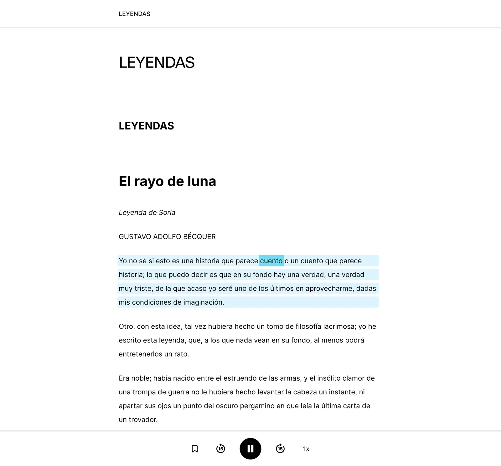
*Nuestro PDF de prueba («El rayo de luna», de Bécquer) en el lector web, mientras lo lee la voz de Sara Martin.*

## 2. El catálogo de audiolibros (y los superventas que faltan)

En **Explore** encuentras secciones como *Top picks*, *What's trending*, *Recent bestsellers* o *Your next listen*, con filtros por etiquetas, género, precio, valoración, narrador e idioma. Con la cuenta en español, aparecen muchos títulos en nuestro idioma.

Junto a cada audiolibro verás su precio:

- **«Free»:** gratis para todos. Son sobre todo **clásicos de dominio público**: *Don Quijote de la Mancha*, *Ana de las Tejas Verdes*, *El retrato de Dorian Gray*, el *Decamerón*…
- **«24 $ · 🎧 0,00 $»:** el primer precio es el de compra; el segundo, el de Ultra. Si pone 0 $, **está incluido en la suscripción**. Por ejemplo, *Neurociencia del cuerpo*, de Nazareth Castellanos.
- **Solo un precio (p. ej., «25 $»):** no está incluido; se **compra aparte**.

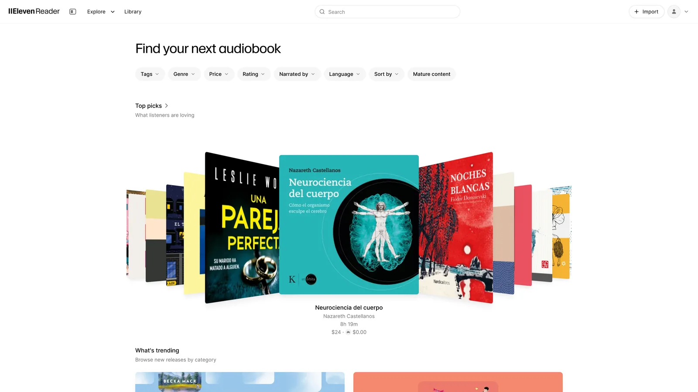
*La página Explore: «24 $ · 0,00 $» significa que el título está incluido en Ultra.*

Ojo a dos límites:

1. **Los audiolibros prémium tienen tope:** con Ultra puedes escuchar **20 horas al mes** de títulos prémium. Se reinician cada mes.
2. **Muchos superventas en español no están.** El 11 de octubre de 2026 buscamos seis éxitos recientes:

| Libro | ¿Está en ElevenReader? |
|---|---|
| *Cien años de soledad* (García Márquez) | Sí, pero **se compra aparte** (25 $, 17 h 28 min) |
| *La sombra del viento* (Ruiz Zafón) | No. Solo aparece una guía de lectura |
| *Patria* (Fernando Aramburu) | No |
| *El infinito en un junco* (Irene Vallejo) | No |
| *Sapiens* (Yuval Noah Harari) | No |
| *La casa de los espíritus* (Isabel Allende) | No |

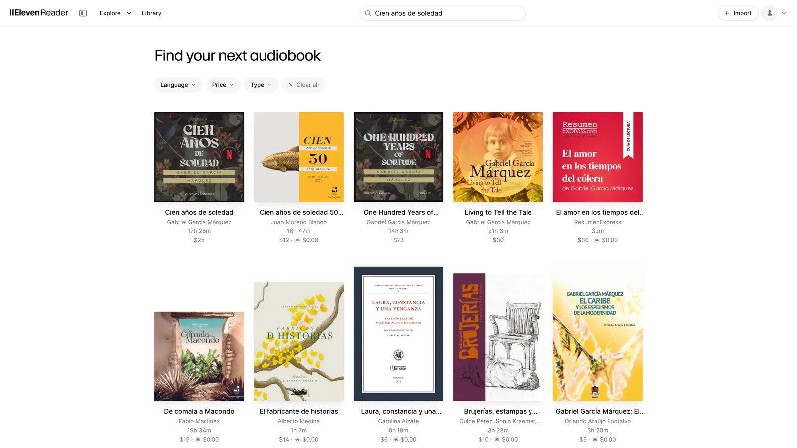
*«Cien años de soledad» está, pero no entra en Ultra: cuesta 25 $.*

> 🔎 **Antes de suscribirte, busca tu libro en [SonorBooks](https://sonorbooks.com):** te decimos en qué plataformas está, con qué narración y a qué precio.

## 3. Tus documentos en audio: probamos con un PDF

Aquí es donde ElevenReader brilla. Pulsando **Import** puedes subir **PDF, DOCX (Word), EPUB, Markdown y TXT**, o **pegar un texto o un enlace** a una web.

Para probarlo, preparamos un PDF de 12 páginas con **«El rayo de luna», de Gustavo Adolfo Bécquer** (dominio público), con **cabecera y número en cada página**, como un libro de verdad.

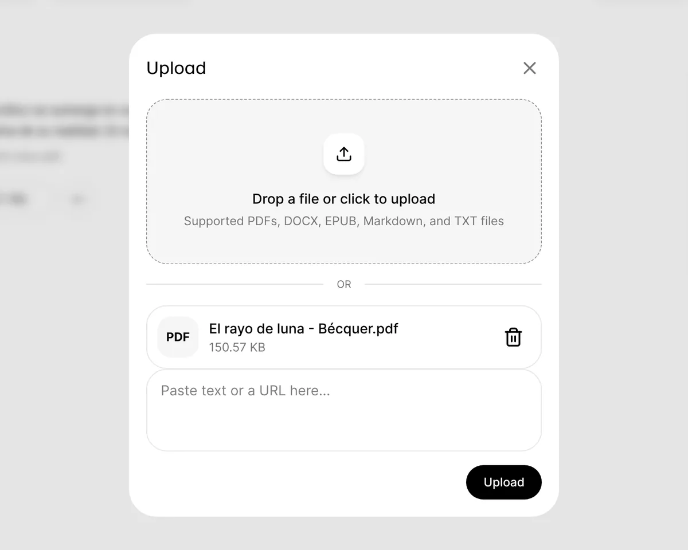
*Subimos el PDF (150 KB). También se puede pegar un texto o un enlace.*

El proceso fue así:

1. Arrastras el archivo y pulsas **Upload**.
2. La app muestra el progreso: *Uploading PDF → Reading PDF → Extracting words → Preparing audio*.
3. En un momento, el documento aparece en tu biblioteca: **22 minutos de audio**.

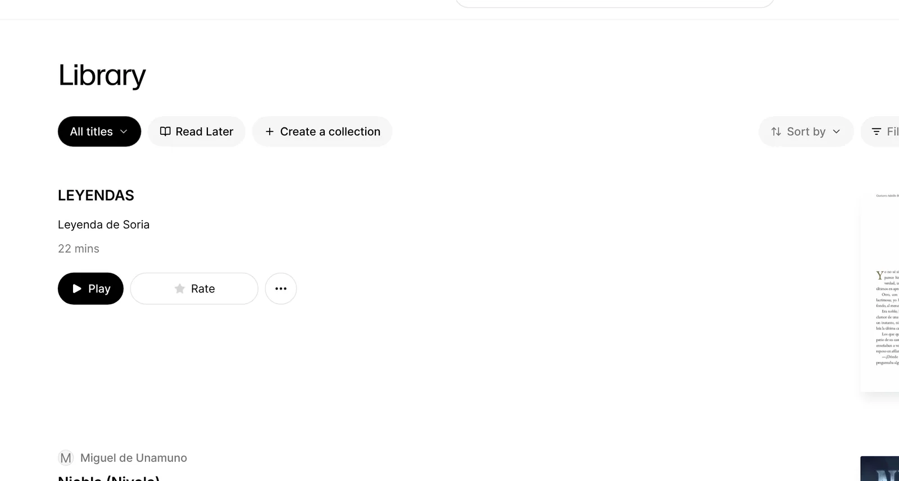

Lo mejor: **quitó él solo las cabeceras y los números de página**, de modo que la voz no lee «Gustavo Adolfo Bécquer · Leyendas» ni «página 3» cada pocos párrafos. Es la *importación inteligente* que anuncia Ultra («salta cabeceras, pies y relleno»), y en nuestra prueba funcionó a la perfección.

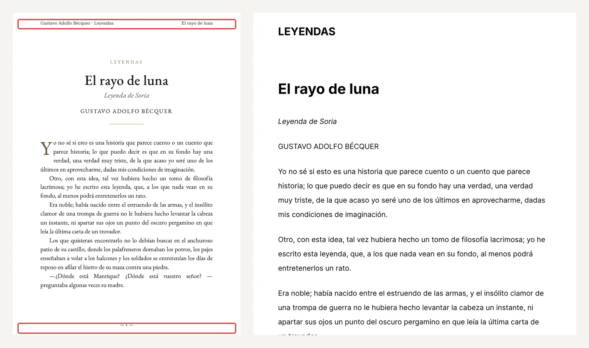
*Izquierda: nuestro PDF, con la cabecera y el número de página marcados. Derecha: lo que lee ElevenReader.*

Un detalle menor: tituló el documento **«LEYENDAS»** (lo sacó de la portada) en lugar de «El rayo de luna». Se arregla en un momento con la opción **Rename**.

## 4. Las voces: de Brian a Sara Martin

Al pulsar **Play**, el texto se resalta **palabra a palabra y por párrafos**: puedes leer y escuchar a la vez, algo muy útil para estudiar o para no perderte.

**Por defecto, nuestro PDF lo leyó Brian**, una de sus voces en inglés que también habla español. Se entiende bien, pero el propio lector te recomienda **voces para español**: *Enrique Rocha™*, *David Martin*, *Sara Martin*, *Antonio* o *Carmelo*, entre otras. Con **Sara Martin**, la lectura de Bécquer ganó naturalidad: pausas más humanas y mejor entonación. En el vídeo puedes escuchar las dos.

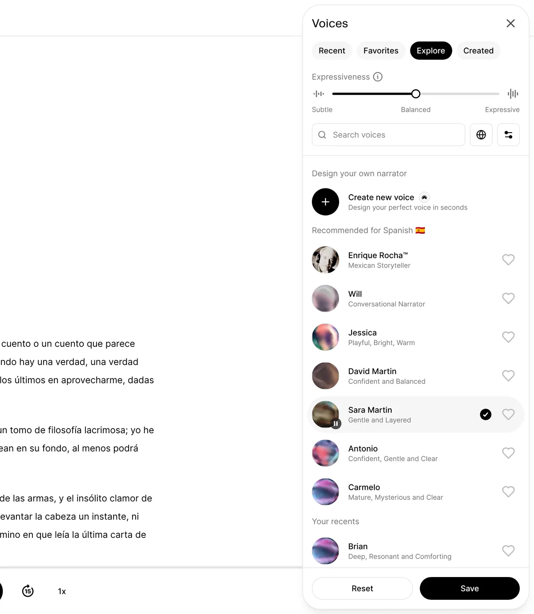

En el panel de voces también puedes:

- **Elegir entre más de 1.000 voces** (pestañas *Recent*, *Favorites*, *Explore* y *Created*), filtrando por idioma.
- **Ajustar la expresividad**, de *Subtle* (sobria) a *Expressive* (más interpretada).
- **Diseñar tu propia voz** con *Create new voice* (las voces personalizadas son una ventaja de Ultra).
- Escuchar **voces icónicas** con licencia, como *Sir Michael Caine™*, *Celia Cruz™*, *Albert Einstein™*, *Richard Feynman™*, *John Wayne™* o *Dr. Maya Angelou™*.

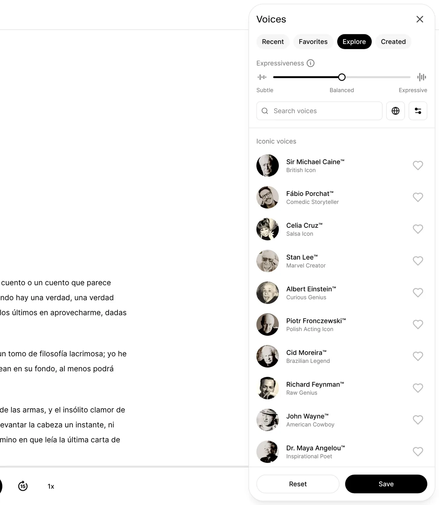

## 5. El lector: todas sus opciones

El reproductor es completo:

- **Capítulos** (índice lateral), **saltos de 15 segundos** adelante y atrás y **marcadores**.
- **Velocidad de lectura**, hasta **4x**.
- Menú de opciones: **buscar en el texto**, marcadores, **mostrar solo el audio**, añadir a **colecciones**, marcar como terminado, **renombrar**, archivar y borrar.

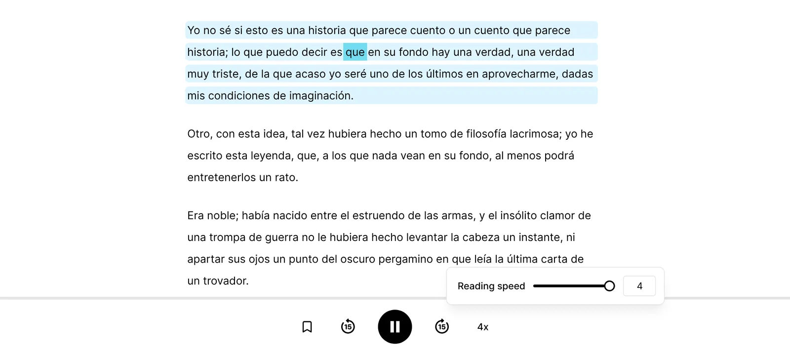

Y en **Customize** (preferencias) cambias la experiencia de lectura:

- **Tema:** automático, claro, oscuro o papel.
- **Letra** y **tamaño**, y alineación a la izquierda o justificada.
- **Resaltado** de palabras y de párrafos (se pueden desactivar) y **cinco colores**: *Classic* (verde), *Simple*, *Sky* (azul, el de serie), *Fall* (naranja) y *Highlight* (amarillo).

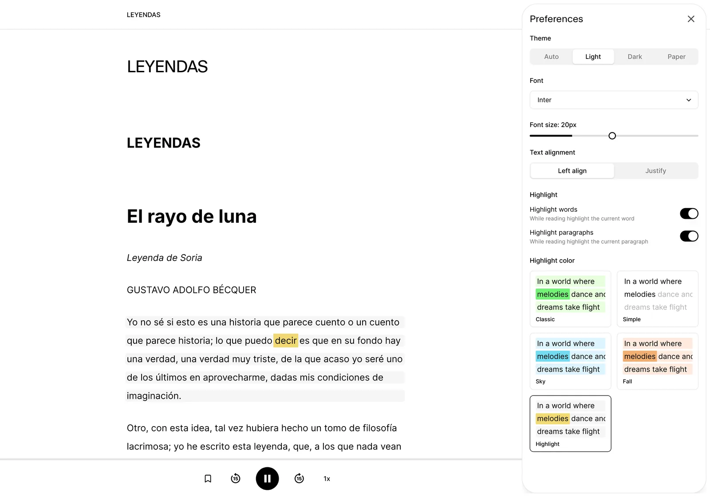
*Con letra a 20 px y el resaltado «Highlight».*

## 6. Más funciones (y lo que cambia en el móvil)

- **Extensión para Chrome:** guarda cualquier web en tu biblioteca en un clic.
- **Importación automática** de lo que descargas (EPUB, PDF y TXT), activable en los ajustes de la cuenta.
- **Colecciones** para ordenar tu biblioteca y una lista **Read Later**.
- **Contador de uso** (*My usage*): cuánto te queda de texto a audio (se reinicia cada día con Ultra) y de títulos prémium (cada mes). Si te quedas corto, puedes comprar **horas extra**.

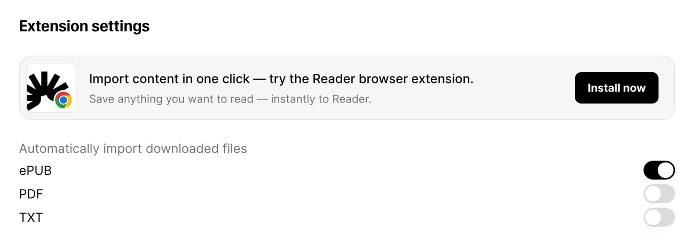

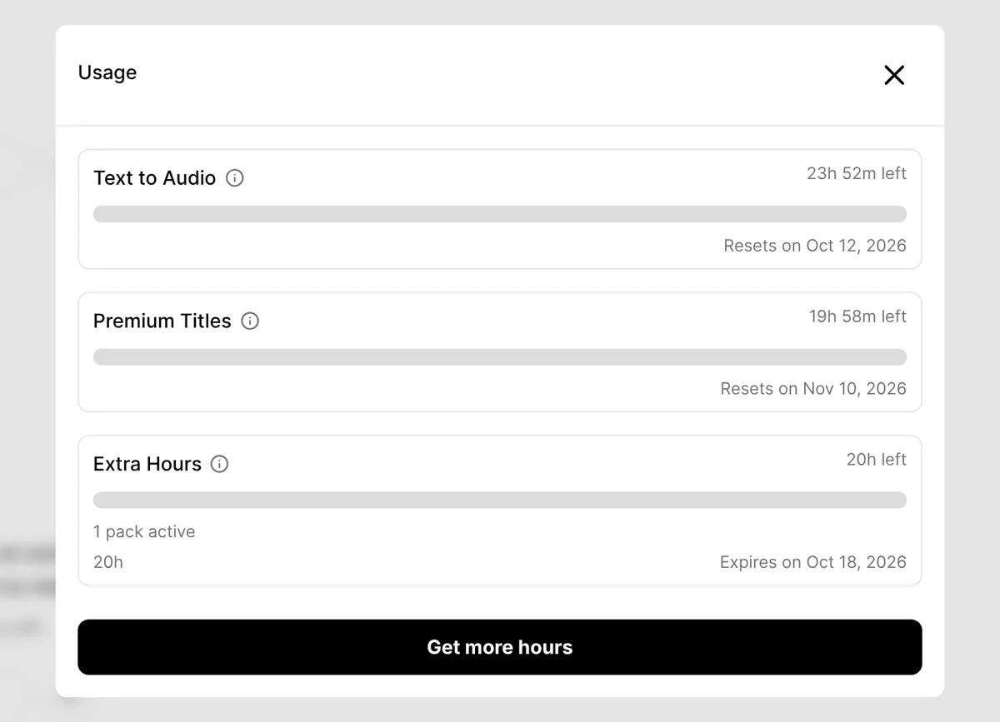

En el **móvil** (iPhone y Android) tienes, además, **descargas para escuchar sin conexión** (con Ultra) y **temporizador para dormir**. La propia web te invita a instalar la app con un código QR.

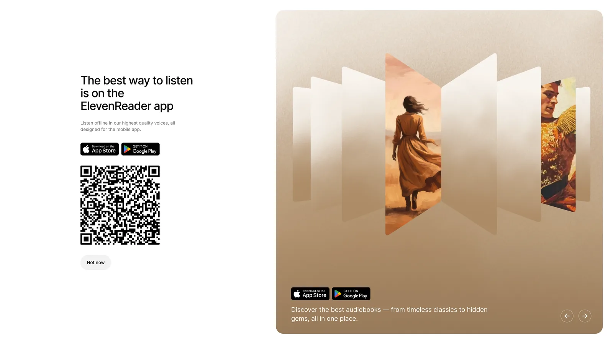

## 7. Planes y precios

| | Gratis | Ultra |
|---|---|---|
| **Precio en la web** | 0 $ | **11 $/mes** o **99 $/año** (8,25 $/mes), más IVA |
| **Precio en la App Store (España)** | 0 € | 12 €/mes o 99 €/año |
| **Texto a audio (tus documentos)** | 10 h al mes | Sin límite práctico (hasta 24 h de audio al día) |
| **Audiolibros** | Miles gratis | + más de 200.000 prémium, **20 h al mes** |
| **Voces** | Más de 1.000 | + voces personalizadas |
| **Descargas sin conexión** | No | Sí (150 h al mes) |
| **Importación inteligente** (sin cabeceras ni pies) | No | Sí |
| **Velocidad, temporizador y marcadores** | Sí | Sí |

*Precios de elevenreader.io/pricing y de la App Store de España, consultados el 11 de octubre de 2026.*

**¿Cuánto pagamos nosotros?** Nos dimos de alta en la web con el enlace de SonorBooks, en el plan mensual. La factura que nos muestra para el primer cobro, tras la prueba, es:

| Concepto | Importe |
|---|---|
| Ultra mensual | 11,00 $ |
| Descuento de SonorBooks (15 %) | −1,65 $ |
| IVA (21 %) | +1,96 $ |
| **Total al mes** | **11,31 $** |

En nuestra cuenta, el descuento se aplica **los primeros meses** (hasta abril de 2027). En el pago anual, la oferta muestra **84,15 $ al año** (7,01 $ al mes). Ojo: en la web se paga **en dólares**, así que tu banco puede aplicar comisión de cambio.

## 8. Lo mejor y lo peor

### ✅ Lo mejor
- **Voces muy naturales**, sobre todo si eliges una recomendada para español.
- **Convierte casi cualquier texto en audio:** PDF, EPUB, Word, Markdown, TXT, textos pegados y webs.
- **Importación inteligente:** en nuestra prueba quitó cabeceras y números de página.
- **Texto y audio sincronizados**, con resaltado por palabra y por párrafo.
- **Sin límite práctico con Ultra** para tus documentos (hasta 24 h de audio al día).
- **Plan gratis útil:** 10 horas al mes de texto a audio.
- Web, iPhone y Android **sincronizados**.

### ❌ Lo peor
- **La web está en inglés** (la página de alta y la oferta sí están en español).
- **Los audiolibros prémium tienen tope:** 20 horas al mes.
- **Faltan muchos superventas en español**, o se venden aparte.
- **No puedes descargar el audio** (por ejemplo, en MP3) **ni compartir la cuenta**: no hay plan familiar.
- **En la web se paga en dólares**, más IVA.
- La voz por defecto de nuestro PDF era inglesa: conviene **cambiarla a una voz en español**.

## 9. ¿Para quién es?

**Es ideal para:**
- Quien **lee mucho en PDF, ebooks o artículos** y quiere escucharlos: estudiantes, opositores, investigadores, profesionales que reciben informes.
- Quien prefiere **escuchar a leer en pantalla**, o necesita apoyo para leer.
- Quien quiere **leer y escuchar a la vez**, con el texto resaltado.

**No es para ti si:**
- Buscas sobre todo **novedades y superventas en español narrados por personas**: compara antes en [SonorBooks](https://sonorbooks.com).
- Quieres **compartir la suscripción** con tu familia o **descargarte el audio**.

## 10. Cómo conseguir 30 días gratis en vez de 3

En su web, la prueba estándar de Ultra dura **3 días**. Con el enlace de SonorBooks son **30 días gratis** y, cuando empiezan los cobros, **un 15 % de descuento** los primeros meses.

1. **Entra desde SonorBooks.** En la página de inicio, ElevenReader es la última tarjeta de las plataformas: pulsa **«Empezar prueba gratuita»**. O, en esta reseña, pulsa **«Probar gratis»**.
2. **En la oferta**, pulsa el botón naranja **«30 días gratis y ahorra un 15 %»**.
3. **Crea tu cuenta** con Google, Apple o tu correo. Recuerda cuál usas: es la cuenta con la que entrarás en la app.
4. **Elige Ultra** (mensual o anual) y **añade tu tarjeta**. **Hoy pagas 0 €:** el primer cobro llega a los 30 días.
5. **Descarga la app** de ElevenReader y entra con la misma cuenta.

**¿Te ha gustado?** Quédate con la suscripción: no tienes que hacer nada, y los primeros meses pagarás un 15 % menos.
**¿No te convence?** Cancela **antes del día 30** y no pagarás nada:
- **En la web:** avatar → *Account settings* → **Manage billing** (gestionar facturación) → cancelar.
- **Si te suscribiste en el iPhone:** Ajustes → [tu nombre] → Suscripciones.
- **En Android:** Play Store → perfil → Pagos y suscripciones → Suscripciones.

Al cancelar **mantienes el acceso hasta el final del periodo** y después pasas al plan gratis.

## 11. Nuestra nota: 8/10

| Categoría | Nota |
|---|---|
| Voces | **9** |
| Tus documentos en audio | **9,5** |
| Lector y funciones | **8,5** |
| Catálogo de audiolibros en español | **6** |
| Precio | **7** |
| **Nota global** | **8 / 10** |

**¿Merece la pena?** Si lees mucho en PDF, ebooks o artículos, **sí, y mucho**: pocas apps convierten tus textos en audio con esta calidad y tan poco esfuerzo. Si buscas sobre todo superventas en español, ElevenReader se queda corto: **compara antes en SonorBooks**. Y para salir de dudas, lo mejor es probarlo: con nuestro enlace tienes 30 días.

## 12. Preguntas frecuentes sobre ElevenReader

### ¿ElevenReader es gratis?
Tiene un **plan gratis** con 10 horas al mes de texto a audio, más de 1.000 voces y miles de audiolibros gratis. El plan **Ultra** cuesta 11 $/mes o 99 $/año en la web (más IVA), o 12 €/mes en la App Store.

### ¿Cuánto dura la prueba gratis de ElevenReader?
En su web, **3 días**. Con el enlace de SonorBooks, **30 días**, y un 15 % de descuento los primeros meses si decides quedarte.

### ¿ElevenReader lee PDF en español?
Sí. Lo comprobamos con un PDF de Bécquer: lo convirtió en 22 minutos de audio y quitó las cabeceras y los números de página. Para que suene mejor, elige una de las **voces recomendadas para español**.

### ¿Qué formatos admite?
**PDF, EPUB, DOCX (Word), Markdown y TXT**. También puedes **pegar un texto o el enlace** de una web, y guardar páginas con la extensión de Chrome.

### ¿Está «Cien años de soledad» en ElevenReader?
Sí, pero **no está incluido en Ultra**: se compra aparte por 25 $ (octubre de 2026).

### ¿Se puede descargar el audio en MP3?
No. Con Ultra puedes **descargar para escuchar sin conexión** dentro de la app, pero no exportar el audio.

### ¿Se puede compartir la cuenta?
No hay plan familiar: la cuenta es individual.

### ¿Cómo cancelo la suscripción?
En la web: **Account settings → Manage billing**. Si te suscribiste desde el iPhone o Android, se cancela en la tienda (App Store o Google Play). Mantienes el acceso hasta el final del periodo.

---

### Fuentes y metodología
Probamos ElevenReader el **11 de octubre de 2026** en la web, con una cuenta Ultra en periodo de prueba dada de alta con el enlace de SonorBooks: navegamos el catálogo, buscamos seis superventas, subimos un PDF propio de 12 páginas («El rayo de luna», de Bécquer, de dominio público) y lo escuchamos con las voces Brian y Sara Martin.
- [ElevenReader: precios](https://elevenreader.io/pricing)
- [ElevenLabs: cómo cancelar la suscripción de ElevenReader](https://elevenlabs.io/docs/es/help-center/product/mobile-apps/eleven-reader/how-do-i-cancel-my-eleven-reader-subscription)
- [ElevenLabs: cómo funciona el plan Ultra](https://elevenlabs.io/docs/help-center/product/mobile-apps/eleven-reader/how-does-the-ultra-plan-work)
- [ElevenLabs: me suscribí pero la app sigue en el plan gratis](https://elevenlabs.io/docs/es/help-center/product/mobile-apps/eleven-reader/i-subscribed-but-the-eleven-reader-app-still-says-im-on-the-free-version)
- [App Store (España): ElevenReader](https://apps.apple.com/es/app/elevenreader-texto-a-voz/id6479373050)

*Enlace de afiliado: si te suscribes a ElevenReader a través de SonorBooks, podemos recibir una comisión, sin coste para ti. Esto no cambia nuestra opinión: la reseña es independiente, con lo bueno y lo malo. Las capturas y los fragmentos de audio de ElevenReader se usan con fines de reseña y crítica.*

<!-- Datos estructurados (pegar en el <head> o en el campo de schema del CMS) -->

